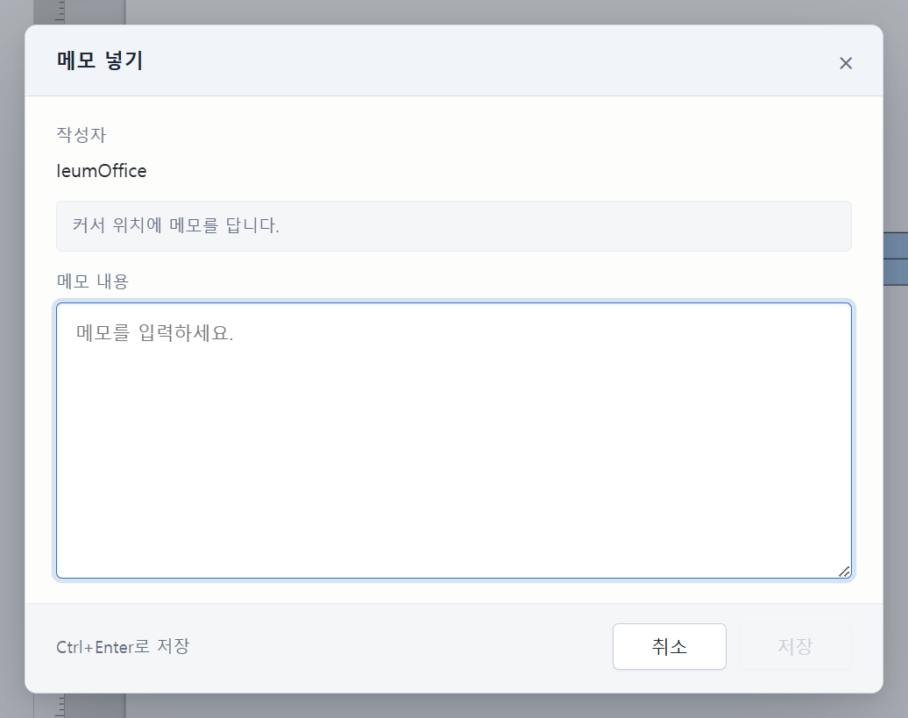
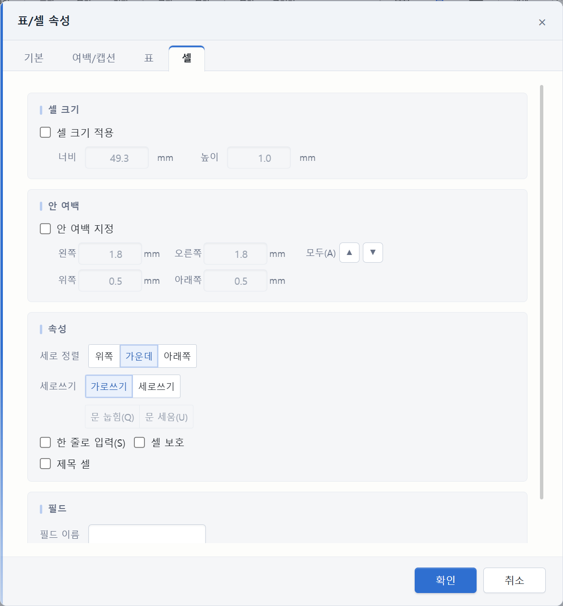
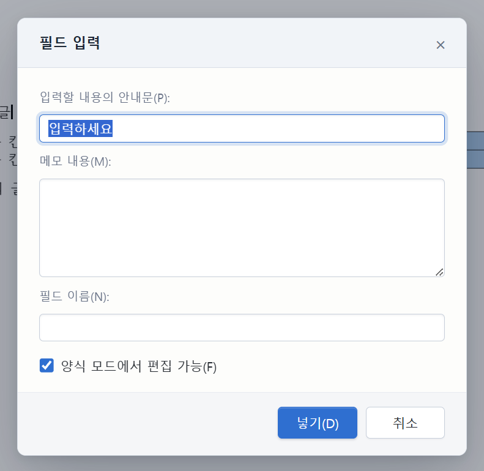
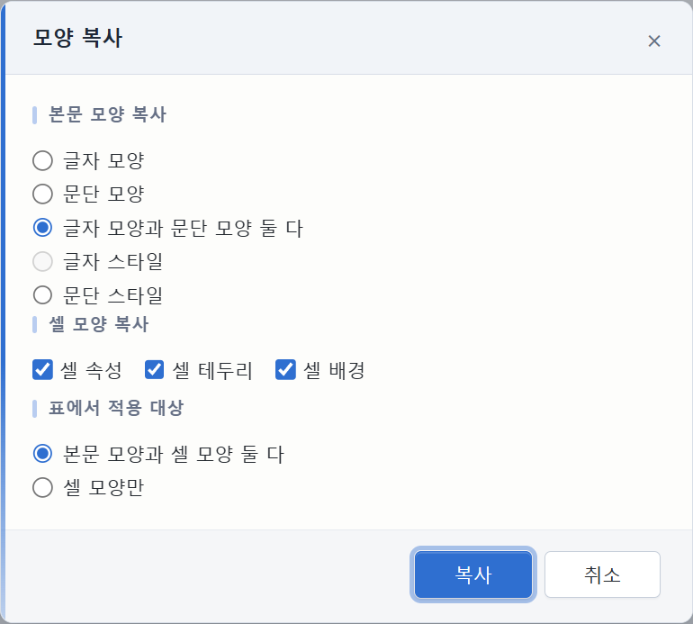
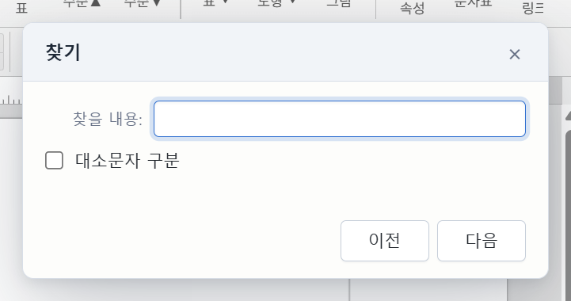

# 한글 편집기 대화상자 디자인 시스템

상태: 구현됨 (2026-10-27). 실제 빌드에서 `표/셀 속성`, `필드 입력`(누름틀의 메모 칸), **메모 넣기**, 모양 복사, 찾기 패널을 열어 확인했다.











## 왜 만들었나

한글 탭의 설정 창은 rhwp-studio의 `ModalDialog` 하나를 함께 쓴다. 그런데 기본 모양은 오래된 Windows 대화상자에 가까워서, 표/셀 속성처럼 폼이 많은 창은 경계가 흐리고 입력 칸과 버튼의 위계가 약했다. 창마다 CSS를 따로 고치면 다음 창은 또 다른 모양이 된다.

그래서 편집기 안의 모든 `.modal-overlay` 대화상자에 한 번에 걸리는 스킨을 두고, 색·모서리·깊이·움직임을 토큰으로 모았다. 새 대화상자는 `ModalDialog`의 기본 클래스만 쓰면 같은 모양을 받는다.

## 범위

- 대상: rhwp-studio의 `ModalDialog`를 쓰는 모든 설정 창. `표/셀 속성`, `테두리/배경`, `필드 입력`(누름틀의 메모 칸), `쪽 설정`, `글자 모양`, `문단 모양`, `스타일`, `환경 설정`, `각주/미주 모양`, `찾아가기`, `개체 속성`, `PDF 인쇄` 등.
- 함께 적용: 모달이 아닌 **찾기/바꾸기 패널**(`.find-dialog`)과, 앱 쪽의 **메모 편집 모달**(`.memo-modal`, `MemoPanel.tsx`)도 같은 토큰과 타이포를 쓴다.
- 앱 모듈이 만드는 `모양 복사` 대화상자도 같은 `ModalDialog`라 함께 적용된다.
- 대상 아님: 탭·AI 창·저장 대화상자 같은 앱 껍데기, 메뉴·도구 줄, 명령 팔레트.

## 메모 창은 두 종류다

- **문서 메모(노란 메모)**: `apps/hwp/src/renderer/MemoPanel.tsx`의 `.memo-modal`이 앱 쪽에서 열린다. rhwp iframe 밖이라 iframe 스킨이 닿지 않으므로 `apps/hwp/src/renderer/dialog-theme.css`가 같은 `--ieum-dialog-*` 토큰으로 맞춘다.
- **누름틀의 메모 칸**: 편집기 iframe 안의 `필드 입력`/`필드 고치기` 대화상자에 있는 `.field-edit-textarea`다. iframe 스킨이 맞춘다.
- 두 토큰 블록은 이름과 값이 같아야 한다. `tests/dialog-theme.test.ts`가 iframe의 `dialog-theme.mjs`와 앱의 `dialog-theme.css`를 읽어 값을 견준다. 앱 쪽은 `[data-theme='dark']`와 시스템 다크 폴백을 함께 가진다.

## 어떻게 붙어 있나

```
apps/hwp/
├── studio-plugin/
│   ├── dialog-theme.mjs   ← iframe 토큰 + 모든 선택자 + installDialogTheme()
│   ├── dialog-theme.d.mts ← 타입 표면
│   ├── agent-plugin.mjs   ← activate()에서 installDialogTheme() 호출
│   └── format-copy.mjs    ← 같은 ModalDialog를 쓰므로 자동 적용
└── src/renderer/
    ├── dialog-theme.css   ← 앱 쪽 토큰 + 메모 편집 모달(.memo-modal)
    └── main.tsx           ← ai-panel.css 뒤에 dialog-theme.css를 읽는다
```

- 스킨은 **런타임 주입**이다. `dialog-theme.mjs`가 `<style id="ieum-dialog-theme">`를 한 번 만들고, `<html data-ieum-dialog-theme="1">`로 범위를 정한다.
- 편집기는 저장소의 정해진 rhwp 태그에서 빌드한다. 벤더 소스를 고치지 않고, 빌드된 CSS 뒤에 우리 층을 얹는다.
- `installDialogTheme()`은 여러 번 불러도 스타일을 겹쳐 넣지 않는다.
- 사용자가 편집기 설정에서 **옛 모드(Old School)** 스킨을 고르면 이 층은 스스로 꺼진다. 다시 기본/모던으로 바꾸면 켜진다(`MutationObserver`).
- 빌드 캐시(`.stamp`)는 `dialog-theme.mjs`의 내용도 해시한다. 이 파일만 고쳐도 편집기가 다시 빌드된다.
- 앱 쪽 `dialog-theme.css`는 Vite가 `main.tsx`에서 읽어 `ai-panel.css` 뒤에 둔다. 그래서 메모 모달의 옛 규칙보다 나중에 적용되고, 토큰은 `:root`·`[data-theme='dark']`·시스템 다크 폴백 세 곳에 있다.

## 모양은 덮고, 배치는 rhwp에 맡긴다

rhwp는 공통 규칙(`.dialog-label`, `.dialog-body` 같은 한 클래스짜리 규칙) 위에 창마다 배치를 따로 정해 둔다. 개체 속성과 수식 속성은 라벨 폭을 넓히고, 글자 모양은 탭을 바꿔도 창 크기가 그대로이게 본문 최소 높이를 두고, PDF로 저장하는 동안에는 푸터를 숨긴다. 스킨이 이 규칙들보다 무거우면 그 배치가 깨진다.

- **색·글꼴·테두리·그림자·여백(창의 뼈대)**은 `:root[data-ieum-dialog-theme] …`로 쓴다. rhwp의 어떤 규칙보다 무거워서 모든 창에 같은 모양이 걸린다.
- **크기·간격·스크롤·보이고 숨기기**(라벨과 입력 칸의 폭, 줄과 구획의 아래 간격, 본문의 최소 높이와 스크롤, 버튼 최소 폭, 비활성 버튼의 커서)는 `:where(:root[data-ieum-dialog-theme]) …`로 쓴다. 무게가 rhwp의 공통 규칙과 같고 `<head>`에서 더 뒤에 있으므로, 공통 규칙은 대신하되 창마다 정한 규칙에는 진다. 푸터의 `display`는 아예 쓰지 않는다.
- rhwp가 상태(`.active`, `:disabled`)를 따로 칠하는 요소를 스킨이 새로 칠했다면, 그 상태도 스킨에서 함께 칠한다(예: 표/셀 속성의 대각선 버튼).
- `<select>`는 Chromium에서 언제나 `:read-only`에 걸린다. 읽기 전용 규칙에 `.dialog-select`를 넣지 않는다.
- 좁은 창(768px 미만)에서 rhwp는 대화상자를 아래에서 올라오는 시트로 바꾼다. 스킨의 좁은 창 규칙도 같은 경계를 쓴다.
- `tests/dialog-theme.test.ts`가 빌드 캐시에 받아 둔 rhwp CSS를 읽어, 무거운 스킨 규칙이 창마다 정한 규칙을 덮는 곳이 있으면 실패한다. 일부러 덮는 곳(모든 창의 높이 상한과 본문 여백, 표/셀 속성의 방향 버튼 등)은 테스트 안의 허용 목록에 이유와 함께 있다.

## 디자인 방향: 종이 위의 잉크, 데스크톱의 정밀함

- **표면**: 살짝 따뜻한 종이 흰색. 어두운 테마에서는 편집기와 같은 슬레이트.
- **잉크**: 본문은 진한 회색, 라벨은 한 단계 흐리게, 단위·안내는 그보다 조금 더 흐리게. 비활성 글자는 별도 토큰(`-ink-disabled`)으로 안내보다 더 조용하게 둔다.
- **액센트**: 왼쪽 세로 리본과 기본 버튼이 가장 강한 파랑이다. 선택된 세그먼트(정렬·방향 등)는 옅은 액센트 배경과 액센트 테두리·글자를 쓰는 **tonal** 상태로 두어, "선택됨"과 "실행"이 같은 무게로 경쟁하지 않게 한다.
- **구획 표시**: 구획 제목 앞의 짧은 막대는 액센트가 아니라 `-accent-line`(옅은 선)으로 둔다. 작은 파랑이 여러 개 늘어서면 리본과 기본 버튼의 의미가 흐려진다.
- **밀도**: 12px UI 글자, 26px 입력, 30px 버튼, 4px 컨트롤 모서리, 8px 창 모서리. 웹 카드가 아니라 사무용 대화상자다.
- **탭**: 종이 폴더 탭. 활성 탭은 본문과 같은 표면으로 이어지고, 위쪽에 2px 액센트 선이 있다.
- **움직임**: 140–180ms의 짧은 페이드/8px 부상. `prefers-reduced-motion`이면 끈다.
- **어두운 테마**: 밝은 파랑 버튼에는 어두운 글자를 쓴다(대비 확보). 나머지는 같은 토큰 이름을 덮어쓴다.

## 토큰

모든 이름은 `--ieum-dialog-`로 시작한다. 밝은 테마는 `:root[data-ieum-dialog-theme]`, 어두운 테마는 `[data-theme-effective='dark']`에서 덮어쓴다.

| 토큰                                                                                    | 쓰임                             |
| --------------------------------------------------------------------------------------- | -------------------------------- |
| `--ieum-dialog-font`                                                                    | 대화상자 UI 글꼴(맑은 고딕 우선) |
| `--ieum-dialog-surface`                                                                 | 창 본문                          |
| `--ieum-dialog-surface-sunken`                                                          | 푸터, 섹션, 비활성 필드          |
| `--ieum-dialog-title-surface`                                                           | 제목 줄                          |
| `--ieum-dialog-field-surface`                                                           | 입력·선택·보조 버튼              |
| `--ieum-dialog-ink`, `-ink-muted`, `-ink-hint`, `-ink-disabled`, `-title-ink`           | 본문·라벨·안내·단위·비활성·제목  |
| `--ieum-dialog-line`, `-line-soft`, `-field-line`                                       | 구분선·약한 선·입력 테두리       |
| `--ieum-dialog-accent`, `-accent-strong`, `-accent-soft`, `-accent-line`, `-accent-ink` | 액센트와 그 위 글자              |
| `--ieum-dialog-focus`, `--ieum-dialog-danger`                                           | 포커스 링, 오류                  |
| `--ieum-dialog-radius`, `-radius-control`                                               | 창/컨트롤 모서리                 |
| `--ieum-dialog-shadow`, `-control-shadow`, `-primary-shadow`, `-overlay`                | 깊이                             |
| `--ieum-dialog-ease`, `-field-shadow`                                                   | 움직임, 입력 안쪽 그림자         |

색을 더할 때는 **토큰 블록 안에서만** hex/rgba를 쓴다. 컴포넌트 규칙에는 `var(--ieum-dialog-*)`만 쓴다. `tests/dialog-theme.test.ts`가 이를 확인한다.

## 기본 클래스

rhwp가 이미 쓰는 이름을 그대로 살린다. 새 대화상자는 이 이름만 쓰면 된다.

| 요소                 | 클래스                                                                                                                                                  |
| -------------------- | ------------------------------------------------------------------------------------------------------------------------------------------------------- |
| 창                   | `.dialog-wrap` (폭은 `ModalDialog` 생성자에서)                                                                                                          |
| 제목                 | `.dialog-title`, 닫기 `.dialog-close`                                                                                                                   |
| 본문                 | `.dialog-body`                                                                                                                                          |
| 푸터                 | `.dialog-footer`                                                                                                                                        |
| 버튼                 | `.dialog-btn`, 기본 `.dialog-btn-primary`, 비활성 `disabled`                                                                                            |
| 탭                   | `.dialog-tabs`, `.dialog-tab(.active)`, `.dialog-tab-panel(.active)`                                                                                    |
| 구획                 | `.dialog-section`, `.dialog-section-title`                                                                                                              |
| 줄·라벨              | `.dialog-row`, `.dialog-label`, `.dialog-unit`                                                                                                          |
| 입력                 | `.dialog-input`, `.dialog-select`, `.dialog-text-input`                                                                                                 |
| 선택                 | `.dialog-checkbox`, `.dialog-radio-group`, `.dialog-btn-group`                                                                                          |
| 누름틀·메모 폼       | `.field-edit-body`, `.field-edit-panel`, `.field-edit-label`, `.field-edit-input`, `.field-edit-textarea`, `.field-edit-checkbox-row`                   |
| 표/셀 속성 전용      | `.tcp-*` (스피너, 선 종류, 방향 버튼, 미리보기, 비활성 행)                                                                                              |
| 찾기 패널(모달 아님) | `.find-dialog`, `.find-dialog-title`, `.find-dialog-body`, `.find-dialog-row`, `.find-dialog-label`, `.find-dialog-input`, `.find-dialog-buttons`       |
| 앱 메모 모달         | `.memo-modal-backdrop`, `.memo-modal`, `.memo-modal-head`, `.memo-modal-body`, `.memo-modal-foot`, `.memo-textarea`, `.memo-modal-actions .memo-button` |

## 새 대화상자를 만들 때

1. **`ModalDialog`를 상속한다.** 직접 `overlay`/`dialog`를 만들지 않는다.
2. 본문은 `.dialog-body` 안에서 `.dialog-row`, `.dialog-section`, `.dialog-*` 클래스로 조립한다. 표/셀 속성처럼 탭이 있으면 `.dialog-tabs`를 본문 첫 자식으로 둔다.
3. **색·모서리·깊이를 직접 쓰지 않는다.** `var(--ieum-dialog-*)`를 쓴다. 간격은 이 문서의 밀도(12px 글자, 26px 입력, 30px 버튼, 4/8px 모서리)를 따른다. 새 의미가 필요하면 토큰을 추가하고 밝은/어두운 블록 모두에 넣는다.
4. **한 개짜리 탭은 만들지 않는다.** 탭이 하나뿐이면 스킨이 탭 줄을 숨긴다(제목이 이미 그 창의 이름이다). 선택지가 둘 이상일 때만 탭을 쓴다.
5. **폼이 본문 가장자리까지 차야 하면** `.dialog-body.field-edit-body`처럼 본문 자체에 클래스를 주고, 안쪽 패널이 패딩을 갖게 한다. 본문 패딩과 패널 패딩을 겹치지 않는다.
6. **비활성 상태를 색으로만 알리지 않는다.** `disabled` 속성이나 `.tcp-disabled` 같은 기존 관례를 쓰고, 스킨의 비활성 규칙이 덮이도록 선택자 순서를 확인한다.
7. **어두운 테마와 옛 스킨을 확인한다.** 밝은 테마만 보면 어두운 테마에서 액센트 위 글자가 묻힐 수 있다.
8. 새 선택자를 넣었으면 `tests/dialog-theme.test.ts`의 선택자 목록과 이 문서의 표를 함께 고친다.
9. 앱 쪽 모달은 `.memo-modal`처럼 `src/renderer/dialog-theme.css`에 클래스를 두고 같은 토큰을 쓴다. 토큰을 더하면 iframe과 앱 양쪽에 넣고 `tests/dialog-theme.test.ts`의 값 비교를 통과시킨다.

## 확인한 것

- 빌드한 앱에서 `표 → 표/셀 속성`을 열어 제목·탭·섹션·입력·비활성 행·푸터를 확인했다.
- `입력 → 필드`로 누름틀 대화상자를 열어 메모 칸, 포커스 링, 단일 탭 숨김, 본문/패널 패딩을 확인했다.
- `Alt+C`로 앱의 모양 복사 대화상자를 열어 같은 뼈대가 자동으로 적용되는 것을 확인했다.
- `Ctrl+F` 찾기 패널을 열어 모델리스 패널의 제목·입력·버튼을 확인했다.
- 메모 독에서 `+ 메모 넣기`를 눌러 앱 쪽 `.memo-modal`을 열어 제목·작성자·선택 범위·메모 칸·푸터·포커스 링을 확인했다.
- 미리보기 HTML로 밝은/어두운 테마를 확인했다. 어두운 테마의 기본 버튼은 밝은 파랑 + 어두운 글자다.
- `npm run test -w @genoffice/hwp -- tests/dialog-theme.test.ts` 11건 통과(두 토큰 블록의 값 비교, rhwp 창별 배치 규칙 대조 포함).
- `npm run typecheck -w @genoffice/hwp` 통과.
- 대표 화면은 이 문서에서 쓰는 `docs/plans/hwp-dialog-design/`에 있다.

## 남은 일

- 앱 쪽 메모 모달은 `.memo-modal` 뼈대를 쓴다. 나중에 앱 쪽에 다른 모달을 더하면 이 CSS의 토큰과 같은 클래스 관례를 쓴다.
- 스킨은 런타임 주입이라, rhwp가 대화상자 클래스 이름이나 창별 배치를 바꾸면 조용히 어긋난다. `tests/dialog-theme.test.ts`가 클래스 이름과 창별 배치 규칙을 대조하지만, 이 두 검사는 rhwp 소스가 빌드 캐시(`node_modules/.cache/rhwp-studio/<태그>`)에 있을 때만 돈다. CI의 test 작업은 편집기를 빌드하지 않으므로 건너뛴다. rhwp를 올린 뒤에는 `npm run studio -w @genoffice/hwp`로 받은 다음 이 테스트를 돌리고, 빌드한 앱에서 새 대화상자를 열어 본다.
